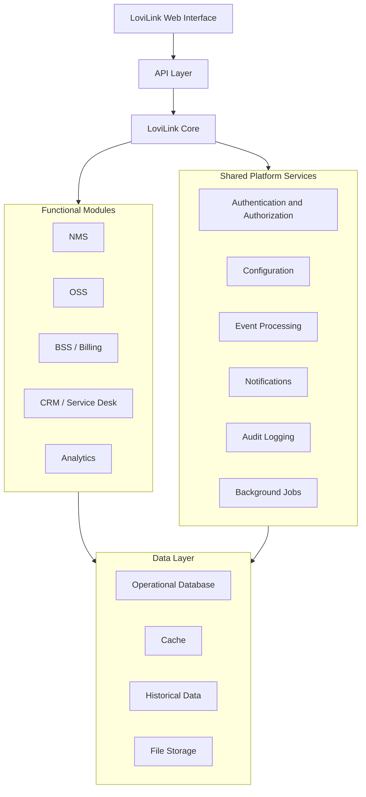
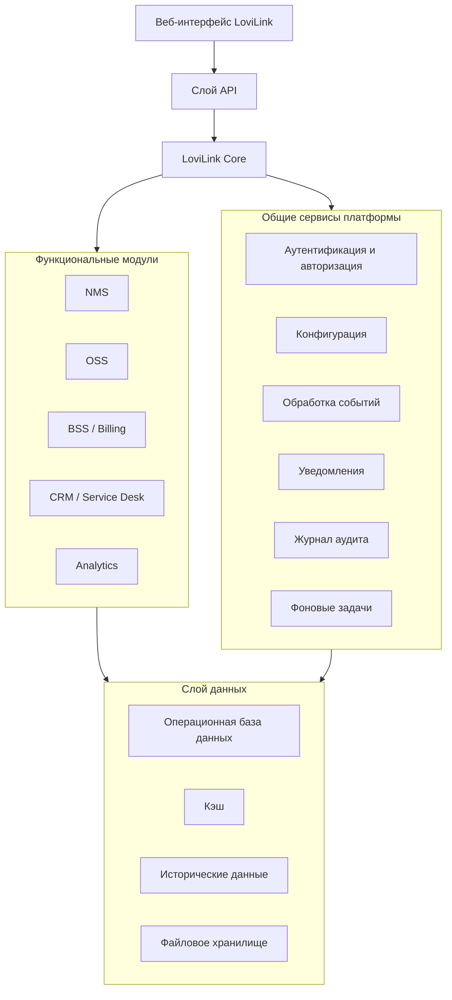

# LoviLink Architecture

## Independent Network Operations & Business Management Platform

**Project:** LoviLink by N3M0  
**Architecture version:** 2.0  
**Status:** Target architecture and development specification  
**Developer:** N3M0

---

# 1. Introduction

LoviLink is an independently developed modular platform designed to manage network infrastructure, operational processes and business activities of telecommunications service providers.

The platform is based on its own architectural model, internal application logic and a set of interconnected functional modules.

The primary architectural objective is to provide a unified environment for network monitoring, infrastructure management, subscriber operations, service management and analytics.

LoviLink is designed to evolve incrementally. Existing functionality is preserved and extended while new modules are introduced through clearly defined interfaces and shared platform services.

## 1.1 Architectural goals

The architecture is intended to provide:

- Modular separation of functional responsibilities.
- Centralized coordination through LoviLink Core.
- Consistent internal and external APIs.
- Shared authentication, authorization and configuration services.
- Unified event and notification processing.
- Controlled access to operational and business data.
- Extensibility and integration capabilities.
- Independent development and testing of modules.
- Scalable deployment options.

## 1.2 Design principles

The platform follows these principles:

1. **Independence:** LoviLink has its own architecture and application logic.
2. **Modularity:** Functional areas are separated into independent modules.
3. **Consistency:** Modules use shared contracts and common platform services.
4. **Extensibility:** New capabilities can be introduced without redesigning the entire platform.
5. **Security:** Access is controlled according to user roles and permissions.
6. **Maintainability:** Components should be testable, documented and replaceable.
7. **Gradual evolution:** Existing functionality is extended rather than unnecessarily rewritten.

---

# 2. High-Level Architecture

The target architecture consists of six primary functional modules coordinated by LoviLink Core.

| Component | Responsibility |
|---|---|
| LoviLink Core | Platform lifecycle, configuration, shared services and module coordination |
| NMS | Network monitoring and operational events |
| OSS | Infrastructure, topology and resource management |
| BSS / Billing | Subscriber accounts, contracts, services and financial operations |
| CRM / Service Desk | Customer interactions, incidents and service requests |
| Analytics | Reports, aggregated metrics and operational analysis |

These modules form the logical architecture. They do not necessarily correspond to separate operating system processes or independent servers.

Their deployment boundaries may evolve according to technical requirements.

## 2.1 Logical architecture diagram

The diagram represents the intended logical relationships, not a claim that all components are already implemented.

---

# 3. LoviLink Core

LoviLink Core is the central architectural component responsible for coordinating platform functionality.

It provides common services and establishes consistent rules for communication between modules.

Core is not intended to contain all business logic. Each functional module remains responsible for its own domain.

## 3.1 Core responsibilities

The target responsibilities include:

- Platform initialization and lifecycle management.
- Module registration and availability.
- Module configuration.
- Internal service coordination.
- API routing and interface contracts.
- Authentication and authorization integration.
- Event distribution.
- Shared logging and audit mechanisms.
- Background task coordination.
- Health checks and service status.
- Common error handling.

## 3.2 Module lifecycle

The intended module lifecycle includes:

1. Registration.
2. Configuration loading.
3. Dependency validation.
4. Initialization.
5. Activation.
6. Health monitoring.
7. Controlled shutdown.

A module should expose its status and supported capabilities through a defined interface.

## 3.3 Module independence

Each module should have:

- A defined functional scope.
- Explicit input and output contracts.
- Controlled access to shared services.
- Independent validation and testing.
- Documented dependencies.
- A defined error-handling strategy.

Modules should not directly modify another module's internal data structures without an explicit interface.

---

# 4. Functional Modules

## 4.1 NMS — Network Management System

NMS provides network monitoring and operational visibility.

### Responsibilities

- Network device monitoring.
- Equipment availability checks.
- Metrics collection.
- Interface and link monitoring.
- Signal and radio-link quality monitoring.
- Client and connected-device information.
- Event and alarm processing.
- Historical measurements.
- Threshold and trigger evaluation.
- SLA-related measurements.
- Monitoring dashboards.

### Data sources

Potential data sources include:

- SNMP.
- HTTP and HTTPS interfaces.
- SSH.
- ICMP.
- Equipment-specific APIs.
- Internal collectors.
- External monitoring integrations.

### Main entities

- Network device.
- Device model.
- Interface.
- Network link.
- Monitoring metric.
- Measurement.
- Trigger.
- Event.
- Alarm.
- Monitoring profile.

### Architectural boundary

NMS is responsible for collecting and interpreting technical monitoring data.

It should not own subscriber contracts, invoices or customer service workflows.

---

## 4.2 OSS — Operations Support System

OSS manages the structure and operational resources of the network.

### Responsibilities

- Network topology.
- Equipment inventory.
- Infrastructure relationships.
- Network segments.
- Physical and logical connections.
- Site and location records.
- Resource allocation.
- Port and interface relationships.
- Infrastructure documentation.
- Operational resource status.

### Main entities

- Site.
- Network node.
- Equipment.
- Connection.
- Port.
- Interface.
- Network segment.
- Resource.
- Infrastructure relationship.

### Architectural boundary

OSS maintains the infrastructure model.

NMS provides observed operational state and measurements. OSS provides the structured representation of network resources.

---

## 4.3 BSS / Billing — Business Support System

BSS manages subscriber-related business operations.

### Responsibilities

- Subscriber records.
- Customer accounts.
- Contracts.
- Service plans.
- Tariffs.
- Account balances.
- Charges.
- Payments.
- Billing periods.
- Financial operation history.
- Service status.

### Main entities

- Subscriber.
- Customer account.
- Contract.
- Service.
- Tariff.
- Invoice.
- Charge.
- Payment.
- Account transaction.

### Architectural boundary

BSS owns subscriber and billing records.

Financial calculations, transaction processing and balance changes must follow explicit business rules and maintain an auditable history.

---

## 4.4 CRM / Service Desk

CRM manages customer interactions and operational service processes.

### Responsibilities

- Customer requests.
- Technical support tickets.
- Incidents.
- Service requests.
- Work assignments.
- Processing stages.
- Priorities.
- Responsible personnel.
- Communication history.
- Resolution tracking.

### Main entities

- Customer interaction.
- Ticket.
- Incident.
- Request.
- Work order.
- Assignment.
- Priority.
- Status.
- Resolution.

### Architectural boundary

CRM manages service workflows.

It may use subscriber information from BSS and technical events from NMS, but remains responsible for its own workflow state.

---

## 4.5 Analytics

Analytics provides consolidated operational and business information.

### Responsibilities

- Network performance reports.
- Availability statistics.
- SLA analysis.
- Infrastructure utilization.
- Subscriber statistics.
- Billing summaries.
- Incident statistics.
- Operational dashboards.
- Historical comparisons.
- Aggregated indicators.

### Data sources

Analytics may consume authorized information from:

- NMS.
- OSS.
- BSS.
- CRM.
- Core operational services.

### Architectural boundary

Analytics should primarily consume data and produce reports.

It must not bypass the ownership and access rules of source modules.

---

# 5. Shared Platform Services

Shared services provide reusable capabilities across the platform.

They are logically coordinated by Core and may be implemented as internal components or independent services when necessary.

## 5.1 Authentication and Authorization

Responsibilities:

- User authentication.
- Session management.
- Role-based access control.
- Permission evaluation.
- Account lifecycle.
- Access restrictions.
- Authentication event logging.

The intended access model includes separate operational and engineering permissions.

Sensitive technical functions and configuration operations should require appropriate permissions.

## 5.2 Configuration Management

Responsibilities:

- Platform configuration.
- Module settings.
- Environment-specific parameters.
- Configuration validation.
- Controlled configuration updates.
- Configuration version tracking.

Secrets must not be stored in public documentation or exposed through ordinary API responses.

## 5.3 Event Processing

The event service provides a unified mechanism for distributing operational events.

Potential event sources include:

- NMS monitoring.
- Infrastructure changes.
- Subscriber service changes.
- Billing operations.
- CRM workflows.
- Platform health checks.

Events should have a consistent structure, timestamp, source, severity and processing status where applicable.

## 5.4 Notification Service

The notification service provides a common delivery interface.

Potential delivery channels:

- Web interface notifications.
- Email.
- Push notifications.
- External messaging services.
- Configurable integrations.

Delivery channels should be replaceable and should not be hard dependencies of functional modules.

## 5.5 Audit Logging

Audit logging records security-sensitive and operationally important actions.

Examples:

- Authentication attempts.
- Permission changes.
- Configuration updates.
- Subscriber record changes.
- Billing operations.
- Administrative actions.
- Module lifecycle operations.

Audit records should preserve the actor, action, timestamp and relevant operation context.

## 5.6 Background Job Processing

Background jobs support asynchronous operations.

Examples:

- Monitoring polling.
- Scheduled checks.
- Historical data processing.
- Report generation.
- Notification delivery.
- Data synchronization.

Jobs should expose execution status, errors and relevant operational metrics.

---

# 6. API Architecture

The API layer provides controlled access to platform functionality.

## 6.1 API principles

- Consistent resource naming.
- Defined request and response formats.
- Authentication and authorization.
- Input validation.
- Predictable error responses.
- Versioning where necessary.
- Documentation.
- Controlled access to module interfaces.

## 6.2 Logical API domains

| API domain | Functional area |
|---|---|
| `/api/core` | Core services and platform status |
| `/api/nms` | Monitoring and network events |
| `/api/oss` | Infrastructure and topology |
| `/api/bss` | Subscribers and billing |
| `/api/crm` | Requests and incidents |
| `/api/analytics` | Reports and aggregated data |

These paths represent the target API organization. Existing endpoints may remain in place during gradual migration.

## 6.3 Inter-module communication

Modules should communicate through documented interfaces.

Preferred communication methods include:

- Internal service interfaces.
- REST APIs.
- Event-based communication.
- Controlled data access services.

Direct database access across module boundaries should be limited and governed by explicit ownership rules.

---

# 7. Data Architecture

The platform requires a structured approach to data ownership and consistency.

## 7.1 Data domains

| Domain | Primary owner |
|---|---|
| Platform configuration | Core |
| User identities and permissions | Core / Identity services |
| Monitoring measurements | NMS |
| Network inventory and topology | OSS |
| Subscriber and contract records | BSS |
| Billing transactions | BSS |
| Tickets and incidents | CRM |
| Aggregated reports | Analytics |

## 7.2 Data storage

The target storage architecture may include:

- Relational database for structured operational records.
- Cache for frequently accessed data.
- Historical storage for time-series measurements.
- File storage for attachments and generated reports.

Storage technologies should be selected according to workload, consistency and operational requirements.

## 7.3 Data consistency

The architecture should provide:

- Clear ownership of records.
- Validated data exchange.
- Referential integrity where applicable.
- Transactional processing for financial operations.
- Traceability of important changes.
- Retention and backup policies.

---

# 8. Security Architecture

Security is a cross-platform requirement.

## 8.1 Access control

- Authentication for protected interfaces.
- Role-based permissions.
- Least-privilege access.
- Restricted engineering operations.
- Session security.
- Controlled API access.

## 8.2 Application security

- Input validation.
- Protection against unauthorized access.
- Secure handling of secrets.
- Safe error reporting.
- Dependency management.
- Security logging.
- Protection of sensitive operational data.

## 8.3 Infrastructure security

- HTTPS for production interfaces.
- Secure database access.
- Restricted management interfaces.
- Firewall and network access policies.
- Protected backups.
- Controlled deployment credentials.

Security controls must be verified during implementation and deployment.

---

# 9. External Integrations

LoviLink is designed to support optional integrations with external systems.

Possible integration categories include:

- Network equipment.
- Monitoring systems.
- Billing platforms.
- Identity providers.
- Notification services.
- Mapping and geolocation services.
- External reporting systems.

Integrations should use adapters or clearly defined interfaces.

The platform's core functionality must remain architecturally independent of any single external vendor or product.

---

# 10. User Interface Architecture

The web interface provides a unified operational workspace.

The target interface may include:

- Overview.
- Devices.
- Topology.
- Subscribers.
- Billing.
- Service Desk.
- Analytics.
- Events.
- Diagnostics.
- Settings.

Visible sections and available actions should depend on user permissions.

The interface should use shared navigation, consistent data presentation and clear separation between technical and business operations.

---

# 11. Deployment Architecture

LoviLink should support gradual deployment options.

## 11.1 Initial deployment model

A single-server deployment may host:

- Web application.
- API services.
- Core components.
- Functional modules.
- Database.
- Cache.
- Background workers.

This model is suitable for initial development and controlled deployments.

## 11.2 Expanded deployment model

As operational requirements grow, components may be separated into dedicated services or servers.

Possible separation areas:

- Application services.
- Database infrastructure.
- Historical metrics storage.
- Background processing.
- File storage.
- Monitoring collectors.

The transition should be based on measured requirements rather than unnecessary infrastructure complexity.

## 11.3 Operational requirements

Production deployment should include:

- Installation and upgrade procedures.
- Configuration management.
- Service health checks.
- Logging and monitoring.
- Backup and recovery.
- Database migration procedures.
- Access management.
- Failure recovery procedures.

---

# 12. Reliability and Observability

The platform should provide mechanisms for understanding its own operational state.

Target capabilities include:

- Service health checks.
- Module availability status.
- Background job monitoring.
- API error tracking.
- Database connection status.
- Resource utilization.
- Structured application logs.
- Operational event history.

Recovery procedures and failure handling should be documented and tested.

---

# 13. Development and Evolution Strategy

LoviLink is developed incrementally.

The architecture is a target design and may evolve as implementation and validation progress.

Development priorities include:

1. Establishing Core responsibilities and shared interfaces.
2. Validating existing monitoring functionality.
3. Formalizing NMS and OSS boundaries.
4. Establishing consistent data ownership.
5. Implementing authentication and authorization.
6. Introducing business modules.
7. Developing analytics.
8. Improving deployment, reliability and security.

Changes should preserve working functionality wherever practical.

Large architectural migrations should be introduced in controlled stages with validation and rollback options.

---

# 14. Current Implementation and Target State

This document describes both the intended architecture and the direction of development.

The existence of an architectural component in this specification does not imply that it has already been implemented.

The current technical implementation includes network monitoring mechanisms, equipment data collection, backend API services, event and alert processing, historical data functionality and a web dashboard.

The complete modular Core architecture, independent business modules, unified data ownership model and expanded deployment capabilities remain subjects of further implementation and validation.

Production readiness must be established through technical testing, security review, operational verification and documented deployment procedures.

---

# 15. Architecture Summary

LoviLink is designed as an independent modular platform for network operations and business management.

Its target architecture combines:

- LoviLink Core.
- Network Management (NMS).
- Operations Support (OSS).
- Business Support and Billing (BSS).
- Customer Relationship and Service Desk (CRM).
- Analytics.

The architecture establishes clear functional boundaries, shared platform services and controlled communication between modules.

Its purpose is to support long-term development while preserving the ability to extend, integrate and operate the platform in different environments.

---

© N3M0. All rights reserved.

---

# Архитектура LoviLink

## Независимая платформа управления сетевыми операциями и бизнес-процессами

**Проект:** LoviLink by N3M0  
**Версия архитектуры:** 2.0  
**Статус:** Целевая архитектура и спецификация развития  
**Разработчик:** N3M0

---

# 1. Введение

LoviLink — самостоятельно разрабатываемая модульная платформа для управления сетевой инфраструктурой, эксплуатационными процессами и бизнес-деятельностью операторов связи.

Платформа строится на собственной архитектурной модели, внутренней прикладной логике и наборе взаимосвязанных функциональных модулей.

Основная архитектурная задача — создать единую среду для мониторинга сети, управления инфраструктурой, работы с абонентами, сервисного обслуживания и аналитики.

LoviLink развивается поэтапно. Существующая функциональность сохраняется и расширяется, а новые модули вводятся через определённые интерфейсы и общие сервисы платформы.

## 1.1 Архитектурные цели

Архитектура предусматривает:

- Модульное разделение функциональных областей.
- Централизованную координацию через LoviLink Core.
- Единые внутренние и внешние API.
- Общие сервисы аутентификации, авторизации и конфигурации.
- Унифицированную обработку событий и уведомлений.
- Контролируемый доступ к техническим и бизнес-данным.
- Возможность расширения и интеграции.
- Независимую разработку и тестирование модулей.
- Различные варианты развёртывания.

## 1.2 Принципы проектирования

Платформа следует следующим принципам:

1. **Самостоятельность:** LoviLink обладает собственной архитектурой и прикладной логикой.
2. **Модульность:** функциональные области разделены на независимые модули.
3. **Согласованность:** модули используют общие контракты и сервисы платформы.
4. **Расширяемость:** новые возможности можно добавлять без полной переработки системы.
5. **Безопасность:** доступ регулируется ролями и разрешениями пользователей.
6. **Сопровождаемость:** компоненты должны быть тестируемыми, документированными и заменяемыми.
7. **Постепенное развитие:** существующая функциональность расширяется без необоснованной полной переработки.

---

# 2. Архитектура верхнего уровня

Целевая архитектура состоит из шести основных функциональных модулей, координируемых LoviLink Core.

| Компонент | Ответственность |
|---|---|
| LoviLink Core | Жизненный цикл платформы, конфигурация, общие сервисы и координация модулей |
| NMS | Мониторинг сети и эксплуатационные события |
| OSS | Инфраструктура, топология и управление ресурсами |
| BSS / Billing | Абонентские записи, договоры, услуги и финансовые операции |
| CRM / Service Desk | Взаимодействие с клиентами, инциденты и сервисные заявки |
| Analytics | Отчёты, агрегированные показатели и операционная аналитика |

Эти модули образуют логическую архитектуру. Они не обязательно должны работать в виде отдельных системных процессов или на независимых серверах.

Границы их развёртывания могут изменяться в зависимости от технических требований.

## 2.1 Диаграмма логической архитектуры

Диаграмма отражает предполагаемые логические связи, а не утверждение о том, что все компоненты уже реализованы.

---

# 3. LoviLink Core

LoviLink Core — центральный архитектурный компонент, отвечающий за координацию функциональности платформы.

Он предоставляет общие сервисы и устанавливает единые правила взаимодействия модулей.

Core не должен содержать всю бизнес-логику платформы. Каждый функциональный модуль сохраняет ответственность за собственную предметную область.

## 3.1 Ответственность Core

Целевые обязанности:

- Инициализация платформы и управление жизненным циклом.
- Регистрация и определение доступности модулей.
- Конфигурация модулей.
- Координация внутренних сервисов.
- Маршрутизация API и управление интерфейсными контрактами.
- Интеграция с механизмами аутентификации и авторизации.
- Распространение событий.
- Общие механизмы журналирования и аудита.
- Координация фоновых задач.
- Проверка состояния сервисов.
- Единая обработка ошибок.

## 3.2 Жизненный цикл модуля

Предполагаемый жизненный цикл включает:

1. Регистрацию.
2. Загрузку конфигурации.
3. Проверку зависимостей.
4. Инициализацию.
5. Активацию.
6. Контроль работоспособности.
7. Управляемое завершение работы.

Модуль должен предоставлять информацию о своём состоянии и поддерживаемых возможностях через определённый интерфейс.

## 3.3 Независимость модулей

Каждый модуль должен иметь:

- Определённую функциональную область.
- Явные контракты входных и выходных данных.
- Контролируемый доступ к общим сервисам.
- Независимые механизмы проверки и тестирования.
- Документированные зависимости.
- Определённую стратегию обработки ошибок.

Модули не должны напрямую изменять внутренние структуры данных друг друга без предусмотренного интерфейса.

---

# 4. Функциональные модули

## 4.1 NMS — Network Management System

NMS обеспечивает мониторинг сети и наблюдаемость её технического состояния.

### Обязанности

- Мониторинг сетевого оборудования.
- Проверка доступности устройств.
- Сбор метрик.
- Контроль интерфейсов и каналов связи.
- Мониторинг уровня сигнала и качества радиолиний.
- Получение информации о клиентах и подключённых устройствах.
- Обработка событий и аварий.
- Хранение исторических измерений.
- Проверка пороговых значений и триггеров.
- Получение показателей для контроля SLA.
- Формирование мониторинговых панелей.

### Источники данных

Возможные источники:

- SNMP.
- HTTP и HTTPS-интерфейсы.
- SSH.
- ICMP.
- Специализированные API оборудования.
- Внутренние сборщики данных.
- Внешние системы мониторинга.

### Основные сущности

- Сетевое устройство.
- Модель устройства.
- Интерфейс.
- Сетевой канал.
- Метрика мониторинга.
- Измерение.
- Триггер.
- Событие.
- Авария.
- Профиль мониторинга.

### Архитектурная граница

NMS отвечает за сбор и интерпретацию технических данных мониторинга.

Он не должен владеть абонентскими договорами, счетами и процессами клиентского обслуживания.

---

## 4.2 OSS — Operations Support System

OSS управляет структурой и эксплуатационными ресурсами сети.

### Обязанности

- Сетевая топология.
- Инвентаризация оборудования.
- Связи между элементами инфраструктуры.
- Сетевые сегменты.
- Физические и логические соединения.
- Площадки и местоположения.
- Распределение ресурсов.
- Связи портов и интерфейсов.
- Документирование инфраструктуры.
- Эксплуатационное состояние ресурсов.

### Основные сущности

- Площадка.
- Сетевой узел.
- Оборудование.
- Соединение.
- Порт.
- Интерфейс.
- Сетевой сегмент.
- Ресурс.
- Инфраструктурная связь.

### Архитектурная граница

OSS хранит структурированную модель инфраструктуры.

NMS предоставляет наблюдаемое эксплуатационное состояние и измерения. OSS предоставляет описание сетевых ресурсов и их взаимосвязей.

---

## 4.3 BSS / Billing — Business Support System

BSS управляет бизнес-операциями, связанными с абонентами.

### Обязанности

- Учёт абонентов.
- Клиентские лицевые счета.
- Договоры.
- Тарифные планы.
- Услуги.
- Балансы.
- Начисления.
- Платежи.
- Расчётные периоды.
- История финансовых операций.
- Состояние услуг.

### Основные сущности

- Абонент.
- Клиентский счёт.
- Договор.
- Услуга.
- Тариф.
- Счёт на оплату.
- Начисление.
- Платёж.
- Операция по лицевому счёту.

### Архитектурная граница

BSS отвечает за абонентские и финансовые записи.

Финансовые расчёты, обработка транзакций и изменение баланса должны выполняться по определённым бизнес-правилам с сохранением истории операций.

---

## 4.4 CRM / Service Desk

CRM управляет взаимодействием с клиентами и сервисными процессами.

### Обязанности

- Обращения клиентов.
- Заявки технической поддержки.
- Инциденты.
- Сервисные запросы.
- Назначение исполнителей.
- Этапы обработки.
- Приоритеты.
- Ответственные сотрудники.
- История коммуникаций.
- Контроль устранения проблем.

### Основные сущности

- Взаимодействие с клиентом.
- Заявка.
- Инцидент.
- Запрос.
- Рабочее задание.
- Назначение.
- Приоритет.
- Статус.
- Решение.

### Архитектурная граница

CRM отвечает за процессы сервисного обслуживания.

Он может использовать абонентские данные из BSS и технические события из NMS, сохраняя ответственность за собственное состояние рабочих процессов.

---

## 4.5 Analytics

Analytics обеспечивает получение сводной технической и бизнес-информации.

### Обязанности

- Отчёты о производительности сети.
- Статистика доступности.
- Анализ SLA.
- Использование инфраструктурных ресурсов.
- Абонентская статистика.
- Сводки по начислениям.
- Статистика инцидентов.
- Операционные панели.
- Исторические сравнения.
- Агрегированные показатели.

### Источники данных

Analytics может получать разрешённую информацию из:

- NMS.
- OSS.
- BSS.
- CRM.
- Общих сервисов Core.

### Архитектурная граница

Analytics преимущественно потребляет данные и формирует отчёты.

Он не должен обходить правила владения данными и управления доступом исходных модулей.

---

# 5. Общие сервисы платформы

Общие сервисы предоставляют повторно используемые возможности для всех модулей.

Они логически координируются Core и могут быть реализованы как внутренние компоненты или самостоятельные сервисы при возникновении такой необходимости.

## 5.1 Аутентификация и авторизация

Обязанности:

- Аутентификация пользователей.
- Управление сессиями.
- Разграничение доступа по ролям.
- Проверка разрешений.
- Жизненный цикл учётных записей.
- Ограничение доступа.
- Журналирование событий аутентификации.

Предполагается разделение инженерных и операционных полномочий.

Доступ к чувствительным техническим функциям и операциям конфигурации должен требовать соответствующих разрешений.

## 5.2 Управление конфигурацией

Обязанности:

- Конфигурация платформы.
- Настройки модулей.
- Параметры отдельных сред.
- Проверка конфигурации.
- Контролируемое изменение настроек.
- Учёт версий конфигурации.

Секреты не должны храниться в публичной документации или передаваться через обычные ответы API.

## 5.3 Обработка событий

Сервис событий обеспечивает единый механизм распространения эксплуатационных событий.

Возможные источники:

- Мониторинг NMS.
- Изменения инфраструктуры.
- Изменения абонентских услуг.
- Операции биллинга.
- Процессы CRM.
- Проверки состояния платформы.

События должны иметь согласованную структуру, временную отметку, источник, уровень важности и статус обработки, если это применимо.

## 5.4 Сервис уведомлений

Сервис уведомлений предоставляет общий интерфейс доставки сообщений.

Возможные каналы:

- Уведомления в веб-интерфейсе.
- Электронная почта.
- Push-уведомления.
- Внешние сервисы обмена сообщениями.
- Настраиваемые интеграции.

Каналы доставки должны быть заменяемыми и не должны становиться жёсткими зависимостями функциональных модулей.

## 5.5 Журнал аудита

Журнал аудита фиксирует важные с точки зрения безопасности и эксплуатации действия.

Примеры:

- Попытки аутентификации.
- Изменения разрешений.
- Обновления конфигурации.
- Изменения абонентских записей.
- Финансовые операции.
- Действия персонала.
- Операции жизненного цикла модулей.

Записи аудита должны сохранять сведения о субъекте, действии, времени и соответствующем контексте операции.

## 5.6 Обработка фоновых задач

Фоновые задачи обеспечивают выполнение асинхронных операций.

Примеры:

- Опрос оборудования.
- Плановые проверки.
- Обработка исторических данных.
- Генерация отчётов.
- Доставка уведомлений.
- Синхронизация данных.

Для задач должны быть доступны состояние выполнения, ошибки и необходимые эксплуатационные показатели.

---

# 6. Архитектура API

Слой API предоставляет контролируемый доступ к функциональности платформы.

## 6.1 Принципы API

- Согласованное именование ресурсов.
- Определённые форматы запросов и ответов.
- Аутентификация и авторизация.
- Проверка входных данных.
- Предсказуемые ответы об ошибках.
- Версионирование при необходимости.
- Документирование интерфейсов.
- Контролируемый доступ к интерфейсам модулей.

## 6.2 Логические домены API

| Домен API | Функциональная область |
|---|---|
| `/api/core` | Сервисы Core и состояние платформы |
| `/api/nms` | Мониторинг и сетевые события |
| `/api/oss` | Инфраструктура и топология |
| `/api/bss` | Абоненты и биллинг |
| `/api/crm` | Заявки и инциденты |
| `/api/analytics` | Отчёты и агрегированные данные |

Эти пути описывают целевую организацию API. Существующие конечные точки могут сохраняться в процессе постепенной миграции.

## 6.3 Межмодульное взаимодействие

Модули должны взаимодействовать через документированные интерфейсы.

Предпочтительные способы взаимодействия:

- Внутренние сервисные интерфейсы.
- REST API.
- Событийное взаимодействие.
- Контролируемые сервисы доступа к данным.

Прямой доступ к базе данных через границы модулей должен быть ограничен и регулироваться правилами владения данными.

---

# 7. Архитектура данных

Платформе необходим структурированный подход к владению данными и обеспечению их согласованности.

## 7.1 Домены данных

| Домен | Основной владелец |
|---|---|
| Конфигурация платформы | Core |
| Пользователи и разрешения | Core / сервисы идентификации |
| Измерения мониторинга | NMS |
| Сетевая инвентаризация и топология | OSS |
| Абоненты и договоры | BSS |
| Финансовые операции | BSS |
| Заявки и инциденты | CRM |
| Сводная отчётность | Analytics |

## 7.2 Хранение данных

Целевая архитектура хранения может включать:

- Реляционную базу данных для структурированных операционных записей.
- Кэш для часто используемых данных.
- Историческое хранилище для временных рядов измерений.
- Файловое хранилище для вложений и сформированных отчётов.

Технологии хранения выбираются в соответствии с нагрузкой, требованиями согласованности и условиями эксплуатации.

## 7.3 Согласованность данных

Архитектура должна обеспечивать:

- Чёткое владение записями.
- Проверенный обмен данными.
- Ссылочную целостность, где она применима.
- Транзакционную обработку финансовых операций.
- Отслеживаемость важных изменений.
- Политики хранения и резервного копирования.

---

# 8. Архитектура безопасности

Безопасность является сквозным требованием для всей платформы.

## 8.1 Управление доступом

- Аутентификация для защищённых интерфейсов.
- Ролевые разрешения.
- Принцип минимально необходимых привилегий.
- Ограничение инженерных операций.
- Безопасность пользовательских сессий.
- Контролируемый доступ к API.

## 8.2 Безопасность приложения

- Проверка входных данных.
- Защита от несанкционированного доступа.
- Безопасная обработка секретов.
- Безопасное отображение ошибок.
- Управление зависимостями.
- Журналирование событий безопасности.
- Защита чувствительных эксплуатационных данных.

## 8.3 Безопасность инфраструктуры

- HTTPS для производственных интерфейсов.
- Защищённый доступ к базе данных.
- Ограничение интерфейсов управления.
- Межсетевые экраны и сетевые политики доступа.
- Защита резервных копий.
- Контролируемое использование учётных данных развёртывания.

Механизмы безопасности должны проверяться в процессе реализации и развёртывания.

---

# 9. Внешние интеграции

LoviLink предусматривает возможность необязательной интеграции с внешними системами.

Возможные категории интеграций:

- Сетевое оборудование.
- Системы мониторинга.
- Биллинговые платформы.
- Провайдеры идентификации.
- Сервисы уведомлений.
- Картографические и геолокационные сервисы.
- Внешние системы отчётности.

Интеграции должны использовать адаптеры или чётко определённые интерфейсы.

Основная функциональность платформы должна оставаться архитектурно независимой от конкретного внешнего поставщика или продукта.

---

# 10. Архитектура пользовательского интерфейса

Веб-интерфейс предоставляет единое рабочее пространство для эксплуатации платформы.

Целевой интерфейс может включать разделы:

- Обзор.
- Устройства.
- Топология.
- Абоненты.
- Биллинг.
- Service Desk.
- Аналитика.
- События.
- Диагностика.
- Настройки.

Видимые разделы и доступные действия должны зависеть от разрешений пользователя.

Интерфейс должен использовать единую навигацию, согласованное представление данных и чёткое разделение технических и бизнес-операций.

---

# 11. Архитектура развёртывания

LoviLink должен поддерживать постепенное расширение вариантов развёртывания.

## 11.1 Начальная модель развёртывания

На одном сервере могут размещаться:

- Веб-приложение.
- API-сервисы.
- Компоненты Core.
- Функциональные модули.
- База данных.
- Кэш.
- Фоновые обработчики.

Эта модель подходит для начальной разработки и контролируемых развёртываний.

## 11.2 Расширенная модель развёртывания

По мере роста эксплуатационных требований компоненты могут разделяться на отдельные сервисы или серверы.

Возможные направления разделения:

- Серверные приложения.
- Инфраструктура базы данных.
- Хранилище исторических метрик.
- Фоновая обработка.
- Файловое хранилище.
- Сборщики мониторинга.

Переход должен основываться на измеренных требованиях, а не на избыточном усложнении инфраструктуры.

## 11.3 Эксплуатационные требования

Производственное развёртывание должно предусматривать:

- Процедуры установки и обновления.
- Управление конфигурацией.
- Проверки работоспособности сервисов.
- Журналирование и мониторинг.
- Резервное копирование и восстановление.
- Процедуры миграции базы данных.
- Управление доступом.
- Процедуры восстановления после отказов.

---

# 12. Надёжность и наблюдаемость

Платформа должна предоставлять механизмы контроля собственного эксплуатационного состояния.

Целевые возможности:

- Проверки состояния сервисов.
- Статус доступности модулей.
- Мониторинг фоновых задач.
- Контроль ошибок API.
- Состояние подключения к базе данных.
- Использование системных ресурсов.
- Структурированные журналы приложения.
- История эксплуатационных событий.

Процедуры восстановления и обработки отказов должны быть документированы и протестированы.

---

# 13. Стратегия разработки и развития

LoviLink разрабатывается поэтапно.

Архитектура представляет собой целевую модель и может изменяться по мере реализации и технической проверки.

Основные направления развития:

1. Определение обязанностей Core и общих интерфейсов.
2. Проверка существующей функциональности мониторинга.
3. Формализация границ NMS и OSS.
4. Создание согласованной модели владения данными.
5. Реализация аутентификации и авторизации.
6. Введение бизнес-модулей.
7. Развитие аналитики.
8. Совершенствование развёртывания, надёжности и безопасности.

Изменения должны по возможности сохранять работающую функциональность.

Крупные архитектурные миграции должны вводиться контролируемыми этапами с проверкой и возможностью отката.

---

# 14. Текущая реализация и целевое состояние

Документ описывает как предполагаемую архитектуру, так и направление развития проекта.

Наличие архитектурного компонента в данной спецификации не означает, что он уже реализован.

Текущая техническая реализация включает механизмы мониторинга сети, сбор данных с оборудования, серверные API-сервисы, обработку событий и оповещений, исторические данные и веб-интерфейс.

Полная модульная архитектура Core, самостоятельные бизнес-модули, единая модель владения данными и расширенные возможности развёртывания остаются предметом дальнейшей реализации и проверки.

Готовность к промышленной эксплуатации должна подтверждаться техническими испытаниями, проверкой безопасности, эксплуатационной верификацией и документированными процедурами развёртывания.

---

# 15. Итоговая архитектурная модель

LoviLink проектируется как самостоятельная модульная платформа управления сетевыми операциями и бизнес-процессами.

Целевая архитектура объединяет:

- LoviLink Core.
- Управление сетью (NMS).
- Эксплуатацию инфраструктуры (OSS).
- Управление бизнесом и биллинг (BSS).
- Взаимодействие с клиентами и Service Desk (CRM).
- Аналитику (Analytics).

Архитектура определяет функциональные границы, общие сервисы платформы и контролируемое взаимодействие между модулями.

Её назначение — обеспечить долгосрочное развитие, сохраняя возможность расширения, интеграции и эксплуатации платформы в различных инфраструктурных средах.

---

© N3M0. Все права защищены.
